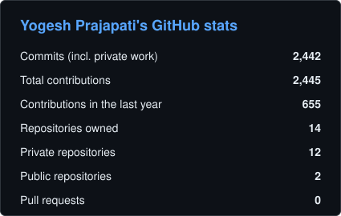
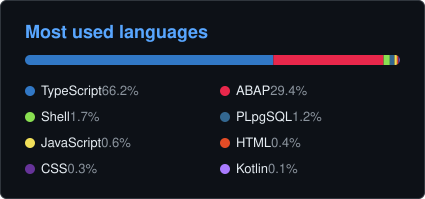

<h1 align="center">Hi, I'm Yogesh Prajapati 👋</h1>
<h3 align="center">SAP ABAP Consultant (8+ years) & Full-stack Developer · Building self-hosted AI platforms at Tapas Infosolutions</h3>

  
  
  

---

### 🧑‍💻 About me

I'm an **SAP ABAP consultant with 8+ years of experience** who also builds full-stack and AI software. At **Tapas Infosolutions LLP** I design enterprise platforms that clients run on their own servers: secure, multi-tenant, fully audited and able to work without internet access.

**What I do**

- 🧾 **SAP ABAP development.** I deliver RICEFW objects end to end, including RFCs, OData services, proxies, BAdIs and enhancements, Smart Forms and Adobe Forms. My main experience is in **FI, MM and SD**, and I have also worked on **PP and QM**.
- 🏗️ **Enterprise platforms.** I build multi-tenant web applications with role-based access, approval workflows, reporting and complete audit trails, using TypeScript, NestJS, React and PostgreSQL.
- 🤖 **Applied AI.** I build on-premise AI services: an AI code workspace, OCR for Indian languages, an LLM gateway with token governance, and shared model hosting.
- 🚀 **Delivery.** I containerise and deploy with Docker, automate server setup with a one-command CLI, and ship branded Android apps for each client.

**How I work:** I keep the client in control of their data, build security and auditability in from day one, and write software that is simple to deploy and maintain.

---

### 🚀 Applications I've built

| Application | What it does | Stack |
|---|---|---|
| **🛠️ Governed AI Code Workspace** | A self-hosted AI coding workspace that each client installs on their own host. Developers code in browser VS Code inside isolated containers. Every change goes through FS approval → dev → test → UAT → final approval, and every action is audited. Code never leaves the host. | TypeScript · Nx · Node 22 · Docker · PostgreSQL |
| **🏛️ Multi-tenant Public Office Platform** | A platform for political and public offices, with a separate branded portal for each tenant and strict tenant isolation tests. | NestJS · Fastify · Prisma · Next.js · React · pnpm |
| **🧠 Enterprise Application Framework** | A config-driven platform layer where every app plugs into **one** auth, permission, audit, reporting and AI layer. It has an AI gateway with agent registry and token governance, and it is air-gap capable. | TypeScript · NestJS · Docker · PostgreSQL |
| **🔍 Indic + English OCR** | Printed and handwritten OCR for English and **22 Indian languages**: OpenCV cleanup, a Tesseract/Surya draft, then AI vision transcription with an optional cross-check by a second provider that highlights words where they disagree. | Python · FastAPI · OpenCV · Tesseract · Claude / Gemini / OpenAI |
| **✅ ISO 9001 Quality Management Suite** | **Three apps on one backend**: QA/QC & document governance, offline-first Lesson Learned capture, and CAR/corrective actions, with approvals, dashboards and Excel export. | React · Express · Drizzle ORM · PostgreSQL |
| **🧩 Shared On-premise AI Model Service** | One model service per server, so each model is loaded once instead of once per app. It serves embeddings (bge-m3) and an LLM (Qwen 2.5 via Ollama, OpenAI-compatible). | Docker · Ollama · HF TEI |
| **⌨️ Server Deployment CLI** | A single command-line tool to install, update and run every app on a server, with shell completion and tests. | Bash |
| **📱 White-label Android Apps** | Signed Android WebView apps for platform tenants, each with its own branding, splash screen and app name. | Kotlin · Gradle KTS |
| **🧾 SAP ABAP Solutions** | Custom developments across FI, MM, SD, PP and QM: reports, interfaces and integrations, enhancements, print forms and workflows, built to fit each business process. | ABAP · RFC · OData · Proxy · BAdI · Smart Forms · Adobe Forms |

---

### 🧰 Tech stack

**Languages** 

**SAP (8+ years)** 

**Frameworks** 

**Data, infrastructure and AI** 

---

### 📊 GitHub stats

  
  

  

---

<i>Building software that clients can run on their own servers, with AI they can audit.</i>

